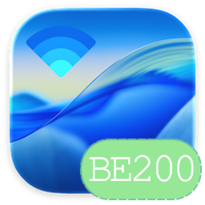

<p align="center"></p>

<h1 align="center">Eric-AirportItlwm</h1>
<p align="center"><b>Native macOS Wi-Fi for Intel cards, from 802.11n to Wi-Fi 7</b><br>
macOS Tahoe 26 and Sequoia 15 · WPA3 · 6 GHz · 802.11be · BE200 / BE201 and every card itlwm supports</p>

<p align="center">
<a href="https://github.com/Ersiter/Eric-AirportItlwm/releases/latest"></a>


</p>

<p align="center"><a href="README.zh-CN.md">简体中文</a></p>

---

AirportItlwm taken from Wi-Fi 6 to Wi-Fi 7 (BE200, BE201), with AirDrop and Instant Hotspot on the way.
Every card it supported still works, on macOS's own Wi-Fi, with no HeliPort.

## What works

| Feature | Cards | Status |
|---|---|---|
| Scan, join, roam, private Wi-Fi address | all | ✅ |
| WPA2-Personal, WPA2-Enterprise (PEAP), WPA2/WPA3 transition networks | all | ✅ |
| WPA3-Personal (SAE, H2E), Enhanced Open (OWE) | all | ✅ on BE200 |
| 802.11ac (VHT), 160 MHz | AC and newer | ✅ |
| 802.11ax (HE) | AX and BE | ✅ with `itlwm_he=1` |
| 6 GHz | AX210/AX211/AX411, BE | ✅ on BE200 |
| 802.11be (EHT), 320 MHz, multi-link (eMLSR) | BE | ✅ 320 MHz on hardware; a multi-link router joins; link pairing still experimental |
| Sleep and wake, recovery from firmware errors | all | ✅ |
| AirDrop / AWDL | AX and BE | 🧪 in development, see [Continuity](#continuity) |
| Instant Hotspot (iPhone in the Wi-Fi menu) | all | 🧪 in development |

**Measured on a BE200** (macOS 26, 6 GHz, 320 MHz, two streams): link rate 2882 Mbit/s, **2.55 Gbit/s
transmit and 1.84 Gbit/s receive** on the interface. 5 GHz HE at 160 MHz. Sleep: reconnects at once after
any length of sleep (tester reports).

## Supported cards

| Generation | Cards | PCI device IDs (`8086:xxxx`) | HAL / firmware |
|---|---|---|---|
| Wi-Fi 7 | BE200, BE202, Killer BE1750 x/w | `272B` | iwx, MLD API 92 (86) |
| Wi-Fi 7 | BE201, Killer BE1750 i/s | `A840` `7740` `4D40` | iwx, MLD API 92 |
| Wi-Fi 6E | AX210, AX211, AX411 | `2725` `2726` `7A70` `7AF0` `51F0` `51F1` `54F0` `7F70` `2729` `7E40` | iwx, API 68 |
| Wi-Fi 6 | AX200, AX201, AX1650 | `2723` `2720` `02F0` `06F0` `34F0` `3DF0` `4DF0` `43F0` `A0F0` | iwx, API 68 |
| Wi-Fi 5 | 9260, 9461, 9462, 9560, 8265, 8260, 7265, 7260, 3168, 3165, 3160 | see [Info.plist](AirportItlwm/WCL/Info.plist) | iwm |
| Wi-Fi 4 | 6xxx, 5xxx, 4965, 2200, 2230, 1000, 1030, 100, 105, 130, 135 | see [Info.plist](AirportItlwm/WCL/Info.plist) | iwn |

The firmware for every card is built into the kext. For the BE family the hardware revision picks the
firmware and the highest adapted API is tried first. Not supported yet: the Wi-Fi 7 "SC" generation
(BE211/BE213, `6E70` `D240` `D340` `E340` `E440` `9327`), which needs firmware this project does not ship.

## Install

1. Download the package for your macOS from [Releases](https://github.com/Ersiter/Eric-AirportItlwm/releases):
   `macOS26-Tahoe` for macOS 26, `macOS15-Sequoia` for macOS 15.2 or later. **Release** for daily use;
   **Debug** keeps the diagnostic logs a report needs.
2. Put the kext in `EFI/OC/Kexts/` and add it to `Kernel → Add`. Use only one Intel Wi-Fi kext.
   If one config boots both systems, limit the Tahoe kext to Darwin `25.0.0`–`25.99.99` and the
   Sequoia kext to `24.2.0`–`24.99.99`.
3. Do not combine it with OpenCore Legacy Patcher's "Modern Wireless" root patches or any IO80211 /
   Skywalk replacement: this driver uses the system's own Wi-Fi stack.
4. Keep a bootable copy of your EFI and test from a USB stick first.

The country and the channels allowed in it come from the networks around you, through the card's own
regulatory logic, as on Linux. There is nothing to set.

### Boot arguments

| Argument | Effect |
|---|---|
| `itlwm_he=1` | Enable 802.11ax/be (HE/EHT). Off by default |
| `itlwm_gl_api=86` | Limit BE200/BE202 to firmware API 86 |
| `-itlawdl …` | Experimental AirDrop, see below. Leave out unless testing |

## Continuity

**Instant Hotspot.** The Bluetooth wake-up of the iPhone's hotspot, the directed scan and the WPA3
association work; the iPhone currently drops the link right after the four-way handshake. This is the open
bug, and the fix applies to every card.

**AirDrop (AWDL).** `awdl0` is created and macOS's own AWDL stack drives it. AirDrop needs the card to
listen on AWDL's channel while staying on your network. Every Intel card except the AX411 has a single
radio (Wi-Fi 7 eMLSR is single radio too), so the firmware time-shares the two:

- **AX cards** (pre-MLD firmware): a standing listener with its own channel context, the construction
  [ForbiddenItlwm](https://github.com/retropineaple/ForbiddenItlwm) runs on the AX211 with AirDrop working
  both ways.
- **BE cards** (MLD firmware): the same idea in the MLD command set, as a P2P client link next to the
  station link (the combination Linux allows on two channels). The firmware's activation rules are being
  worked out from its own code; not working yet.
- **AC and older:** not planned.

Bluetooth LE advertising and scanning must work on macOS first. Test packages ship a matching
[BlueToolFixup](https://github.com/acidanthera/BrcmPatchRAM) with `-btlfxadvsets` (LE advertising sets for
third-party controllers, macOS 26.4–26.7.3) and `-btlfxrpa` (connecting to an iPhone that uses a private
address; macOS 26.4 and 26.7 so far). With `-itlawdl` the driver first checks that Apple's AWDL interface
table has the layout it was built for (`AWDLBuildCheck` in the I/O Registry) and otherwise runs as plain
Wi-Fi, so a macOS update cannot turn it into a kernel panic. The listening channel is 149, then 44, then 6,
and only one the country allows transmitting on (44 where there is no 149; a passive channel once a nearby
router is heard beaconing on it). 149 is fastest: routers on 149 and an iPhone on 149 or off Wi-Fi give the
best AirDrop speed.

## Reporting a problem

Use the Debug package. Reproduce the problem once, then run `Collect-WiFi-Community.command` from the
package and attach the archive to a [GitHub issue](https://github.com/Ersiter/Eric-AirportItlwm/issues)
with your card, macOS build, router model, security mode and what you did. For a Wi-Fi 7 router say
whether MLO is on and which bands it combines. The archive holds network metadata: send it privately if
you prefer. A build that compiles is not a result; please say what you saw on your machine.

## Build

```sh
git clone https://github.com/acidanthera/MacKernelSDK.git MacKernelSDK
git -C MacKernelSDK checkout 3f750085caa17ec3a7880f11c11bf4f48cd6a164
python3 scripts/prepare_tahoe_sdk.py
xcodebuild -project itlwm.xcodeproj -scheme AirportItlwm-Tahoe   -configuration Release ARCHS=x86_64 CODE_SIGNING_ALLOWED=NO build
xcodebuild -project itlwm.xcodeproj -scheme AirportItlwm-Sequoia -configuration Release ARCHS=x86_64 CODE_SIGNING_ALLOWED=NO build
```

The Wi-Fi 7 implementation notes, the per-stage hardware status and the Linux references are in
[BE200.md](BE200.md).

## Lineage

**itlwm** by [zxystd](https://github.com/zxystd) / [OpenIntelWireless](https://github.com/OpenIntelWireless/itlwm)
→ [laobamac/itlwm](https://github.com/laobamac/itlwm) (the native Tahoe/Sequoia Apple wireless interface) →
this tree, which keeps all of it and adds the Wi-Fi 7 transport and MLD firmware path, WPA3 SAE/H2E and OWE,
6 GHz, 320 MHz and multi-link, following Linux `iwlwifi` (`mld`, `mvm`) and `mac80211` command by command.

## Credits

- [zxystd](https://github.com/zxystd) and [OpenIntelWireless](https://github.com/OpenIntelWireless): itlwm and AirportItlwm
- [laobamac](https://github.com/laobamac/itlwm): the native IO80211 / Skywalk / WCL interface for Tahoe and Sequoia, and its review and direction
- [OpenBSD](https://github.com/openbsd/src), Stefan Sperling and contributors: net80211, iwn, iwm, iwx and the SAE implementation
- [BearSSL](https://bearssl.org/), Thomas Pornin: P-256 arithmetic for SAE
- [Linux iwlwifi and mac80211](https://github.com/torvalds/linux/tree/master/drivers/net/wireless/intel/iwlwifi): the behavioural reference for every firmware command
- [hostap / wpa_supplicant](https://w1.fi/): SAE, RSNXE and handshake behaviour
- [retropineaple/ForbiddenItlwm](https://github.com/retropineaple/ForbiddenItlwm): AWDL on Intel cards; the AX listener and the AWDL table check follow it
- [crazyhulk](https://github.com/crazyhulk): AWDL interface groundwork and the BlueToolFixup BLE patches
- [seemoo-lab/owl](https://github.com/seemoo-lab/owl): open AWDL implementation used as a protocol reference
- [Acidanthera](https://github.com/acidanthera): MacKernelSDK, Lilu, BrcmPatchRAM / BlueToolFixup
- Mieze, for macOS receive-path guidance
- The projects itlwm credits: [Black80211-Catalina](https://github.com/AppleIntelWiFi/Black80211-Catalina), [black80211](https://github.com/rpeshkov/black80211), [Voodoo80211](https://github.com/mercurysquad/Voodoo80211), usr-sse2 and others
- Intel, for the firmware, distributed under [Intel's firmware license](iwlwifi-firmware-license)
- Everyone who sent routers, hardware and logs

## License

GPL-2.0, as inherited from itlwm. Intel firmware is distributed under its own license.
