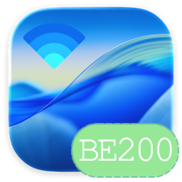

<p align="center"></p>

<h1 align="center">Eric-AirportItlwm</h1>
<p align="center"><b>Intel 无线网卡的 macOS 原生驱动，从 802.11n 到 Wi-Fi 7</b><br>
macOS Tahoe 26、Sequoia 15 · WPA3 · 6 GHz · 802.11be · BE200 / BE201 以及 itlwm 支持的全部网卡</p>

<p align="center"><a href="README.md">English</a></p>

---

在 AirportItlwm 的 Wi-Fi 6 基础上做到了 Wi-Fi 7（BE200、BE201），并在做隔空投送、即时热点。
原有网卡全部保留，用的是 macOS 自带的 Wi-Fi，不需要 HeliPort。

## 功能

| 功能 | 网卡 | 状态 |
|---|---|---|
| 扫描、连接、漫游、私有 Wi-Fi 地址 | 全部 | ✅ |
| WPA2 个人级、WPA2 企业级（PEAP）、WPA2/WPA3 过渡网络 | 全部 | ✅ |
| WPA3 个人级（SAE、H2E）、增强型开放网络（OWE） | 全部 | ✅ BE200 实机 |
| 802.11ac（VHT）、160 MHz | AC 及以上 | ✅ |
| 802.11ax（HE） | AX、BE | ✅ 需 `itlwm_he=1` |
| 6 GHz | AX210/AX211/AX411、BE | ✅ BE200 实机 |
| 802.11be（EHT）、320 MHz、多链路（eMLSR） | BE | ✅ 320 MHz 实机；可加入开启 MLO 的路由器；链路配对仍属实验 |
| 睡眠唤醒、固件出错自动恢复 | 全部 | ✅ |
| 隔空投送 / AWDL | AX、BE | 🧪 开发中，见[接续互通](#接续互通) |
| 即时热点（在 Wi-Fi 菜单里直接连 iPhone） | 全部 | 🧪 开发中 |

**BE200 实测**（macOS 26，6 GHz，320 MHz，双流）：链路速率 2882 Mbit/s，接口实测**发送 2.55 Gbit/s、
接收 1.84 Gbit/s**；5 GHz HE 160 MHz。睡眠：任意时长睡眠后立即重连（测试者反馈）。

## 支持的网卡

| 代际 | 型号 | PCI 设备 ID（`8086:xxxx`） | 驱动层 / 固件 |
|---|---|---|---|
| Wi-Fi 7 | BE200、BE202、Killer BE1750 x/w | `272B` | iwx，MLD API 92（86） |
| Wi-Fi 7 | BE201、Killer BE1750 i/s | `A840` `7740` `4D40` | iwx，MLD API 92 |
| Wi-Fi 6E | AX210、AX211、AX411 | `2725` `2726` `7A70` `7AF0` `51F0` `51F1` `54F0` `7F70` `2729` `7E40` | iwx，API 68 |
| Wi-Fi 6 | AX200、AX201、AX1650 | `2723` `2720` `02F0` `06F0` `34F0` `3DF0` `4DF0` `43F0` `A0F0` | iwx，API 68 |
| Wi-Fi 5 | 9260、9461、9462、9560、8265、8260、7265、7260、3168、3165、3160 | 见 [Info.plist](AirportItlwm/WCL/Info.plist) | iwm |
| Wi-Fi 4 | 6xxx、5xxx、4965、2200、2230、1000、1030、100、105、130、135 | 见 [Info.plist](AirportItlwm/WCL/Info.plist) | iwn |

所有网卡的固件都已内置。BE 系列按硬件版本选择固件，先试最高的已适配 API。暂不支持：Wi-Fi 7 的
「SC」代（BE211/BE213，`6E70` `D240` `D340` `E340` `E440` `9327`），它需要本项目尚未提供的固件。

## 安装

1. 在 [Releases](https://github.com/Ersiter/Eric-AirportItlwm/releases) 下载对应系统的包：macOS 26 用
   `macOS26-Tahoe`，macOS 15.2 及以上用 `macOS15-Sequoia`。日常用 **Release**；**Debug** 保留反馈问题所需的诊断日志。
2. 放进 `EFI/OC/Kexts/`，在 `Kernel → Add` 里添加，只保留一个 Intel 无线驱动。一份配置同时引导两个系统时，
   Tahoe 版限定 Darwin `25.0.0`–`25.99.99`，Sequoia 版限定 `24.2.0`–`24.99.99`。
3. 不要与 OpenCore Legacy Patcher 的「Modern Wireless」根补丁或任何 IO80211 / Skywalk 替换混用：本驱动用的
   就是系统自带的无线栈。
4. 保留一份能启动的 EFI，先用 U 盘测试。

国家码和可用信道由周围的路由器经网卡自身的法规逻辑确定，与 Linux 相同，不需要设置。

### 启动参数

| 参数 | 作用 |
|---|---|
| `itlwm_he=1` | 打开 802.11ax/be（HE/EHT），默认关闭 |
| `itlwm_gl_api=86` | BE200/BE202 限定固件 API 86 |
| `-itlawdl …` | 实验性隔空投送，见下文，不测试就别加 |

## 接续互通

**即时热点**：蓝牙唤起 iPhone 热点、定向扫描、WPA3 关联都已能完成；目前 iPhone 在四次握手后立刻断开，
这是正在查的问题，修复对所有网卡都有效。

**隔空投送（AWDL）**：`awdl0` 已经创建，由 macOS 自己的 AWDL 协议栈驱动。隔空投送要求网卡一边留在你的
网络上，一边在 AWDL 信道上监听。除 AX411 外所有 Intel 网卡都是单射频（Wi-Fi 7 的 eMLSR 也是单射频），
由固件在两者之间分时：

- **AX 系列**（非 MLD 固件）：常驻监听器，有自己的信道上下文，与 [ForbiddenItlwm](https://github.com/retropineaple/ForbiddenItlwm)
  在 AX211 上实现双向隔空的做法相同。
- **BE 系列**（MLD 固件）：同样的思路换成 MLD 命令集，在主链路旁加一条 P2P 客户端链路（Linux 允许两条
  不同信道的组合）。正在按固件自身代码梳理它的激活条件，尚未走通。
- **AC 及更早**：不在计划内。

前提是蓝牙 LE 广播与扫描在 macOS 上可用。测试包附带配套的 [BlueToolFixup](https://github.com/acidanthera/BrcmPatchRAM)，
支持 `-btlfxadvsets`（第三方控制器的 LE 广播集，macOS 26.4–26.7.3）和 `-btlfxrpa`（连接使用私有地址的 iPhone，
目前支持 macOS 26.4 与 26.7）。加了 `-itlawdl` 时，驱动先检查 Apple 的 AWDL 接口表是否与编译时一致
（I/O Registry 里的 `AWDLBuildCheck`），不一致就只做普通 Wi-Fi，系统更新不会因此变成内核崩溃。
监听信道依次选 149、44、6，只用当地允许发射的信道（没有 149 的国家用 44；被动信道在听到附近路由器的信标后
才算可用）。149 最快：路由器在 149、iPhone 也在 149 或没连 Wi-Fi 时隔空速度最好。

## 反馈问题

请用 Debug 包。先复现一次问题，再运行包里的 `Collect-WiFi-Community.command`，把生成的压缩包附到
[GitHub Issue](https://github.com/Ersiter/Eric-AirportItlwm/issues)，写明网卡、macOS 版本、路由器型号、
加密方式和操作过程；Wi-Fi 7 路由器请说明是否开了 MLO、组合了哪些频段。压缩包含网络元数据，可以私下发送。
能编译不等于能用，请写你在自己机器上看到的结果。

## 编译

```sh
git clone https://github.com/acidanthera/MacKernelSDK.git MacKernelSDK
git -C MacKernelSDK checkout 3f750085caa17ec3a7880f11c11bf4f48cd6a164
python3 scripts/prepare_tahoe_sdk.py
xcodebuild -project itlwm.xcodeproj -scheme AirportItlwm-Tahoe   -configuration Release ARCHS=x86_64 CODE_SIGNING_ALLOWED=NO build
xcodebuild -project itlwm.xcodeproj -scheme AirportItlwm-Sequoia -configuration Release ARCHS=x86_64 CODE_SIGNING_ALLOWED=NO build
```

Wi-Fi 7 的实现说明、各阶段实机状态与对应的 Linux 代码见 [BE200.md](BE200.md)。

## 源流

[zxystd](https://github.com/zxystd) / [OpenIntelWireless](https://github.com/OpenIntelWireless/itlwm) 的 **itlwm**
→ [laobamac/itlwm](https://github.com/laobamac/itlwm)（Tahoe/Sequoia 原生 Apple 无线接口）→ 本仓库：保留以上全部，
并新增 Wi-Fi 7 传输层与 MLD 固件路径、WPA3 SAE/H2E 与 OWE、6 GHz、320 MHz 和多链路，按 Linux `iwlwifi`
（`mld`、`mvm`）与 `mac80211` 逐条命令实现。

## 致谢

- [zxystd](https://github.com/zxystd) 与 [OpenIntelWireless](https://github.com/OpenIntelWireless)：itlwm、AirportItlwm
- [laobamac](https://github.com/laobamac/itlwm)：Tahoe 与 Sequoia 的原生 IO80211 / Skywalk / WCL 接口，以及审阅与指导
- [OpenBSD](https://github.com/openbsd/src)、Stefan Sperling 与贡献者：net80211、iwn、iwm、iwx 与 SAE 实现
- [BearSSL](https://bearssl.org/)，Thomas Pornin：SAE 所用的 P-256 运算
- [Linux iwlwifi 与 mac80211](https://github.com/torvalds/linux/tree/master/drivers/net/wireless/intel/iwlwifi)：每条固件命令的行为参照
- [hostap / wpa_supplicant](https://w1.fi/)：SAE、RSNXE 与握手行为参照
- [retropineaple/ForbiddenItlwm](https://github.com/retropineaple/ForbiddenItlwm)：Intel 网卡上的 AWDL；AX 监听器与 AWDL 接口表检查参照它
- [crazyhulk](https://github.com/crazyhulk)：AWDL 接口的前期工作和 BlueToolFixup 的 BLE 补丁
- [seemoo-lab/owl](https://github.com/seemoo-lab/owl)：开源 AWDL 实现，用作协议参照
- [Acidanthera](https://github.com/acidanthera)：MacKernelSDK、Lilu、BrcmPatchRAM / BlueToolFixup
- Mieze：macOS 接收路径方面的指导
- itlwm 原有致谢的项目：[Black80211-Catalina](https://github.com/AppleIntelWiFi/Black80211-Catalina)、[black80211](https://github.com/rpeshkov/black80211)、[Voodoo80211](https://github.com/mercurysquad/Voodoo80211)、usr-sse2 等
- Intel：固件，按 [Intel 固件许可](iwlwifi-firmware-license)分发
- 所有提供路由器、硬件和日志的测试者

## 许可

GPL-2.0，沿袭 itlwm。Intel 固件按其自身许可分发。
